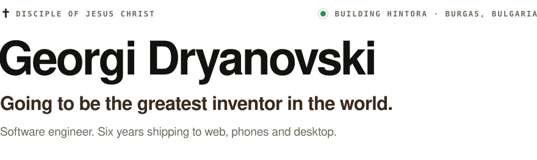
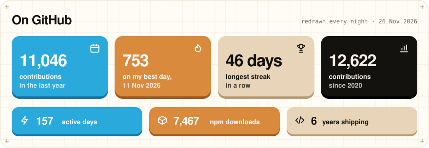
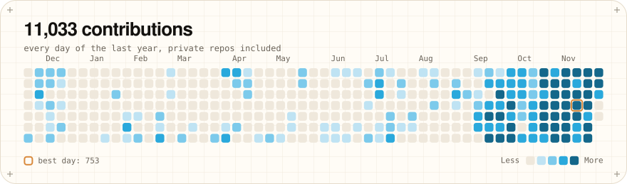
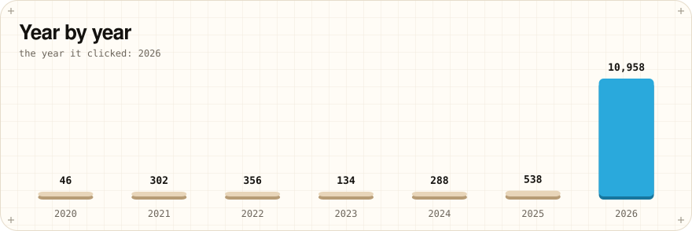
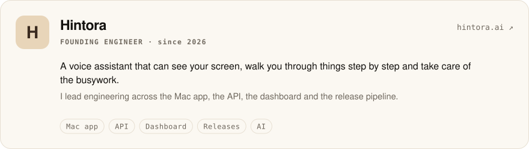
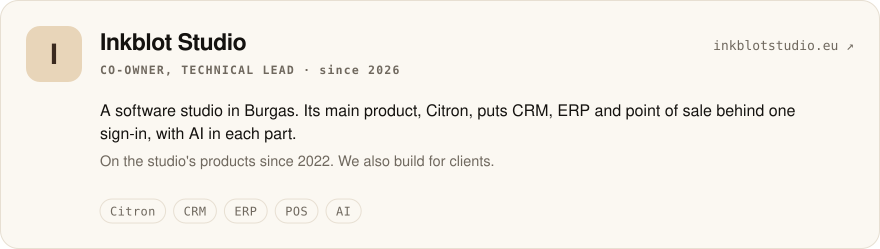
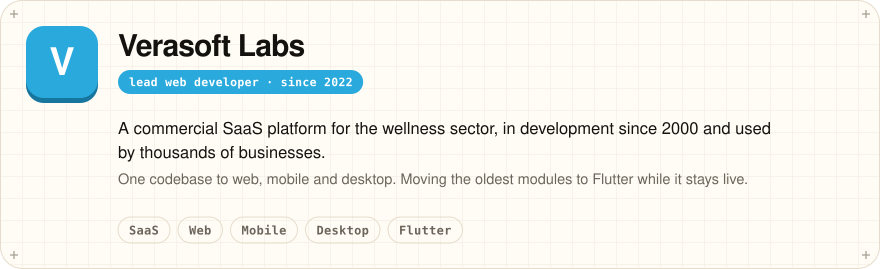
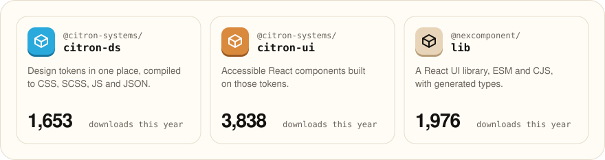
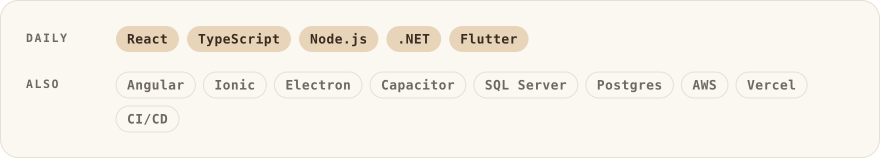

<picture><source media="(prefers-color-scheme: dark) and (max-width: 600px)" srcset="assets/hero-phone-dark.svg"><source media="(max-width: 600px)" srcset="assets/hero-phone-light.svg"><source media="(prefers-color-scheme: dark)" srcset="assets/hero-dark.svg"></picture>

<a href="https://hintora.ai"><picture><source media="(prefers-color-scheme: dark)" srcset="assets/link-0-dark.svg"></picture></a>
<a href="https://inkblotstudio.eu"><picture><source media="(prefers-color-scheme: dark)" srcset="assets/link-1-dark.svg"></picture></a>
<a href="https://www.linkedin.com/in/georgi-dryanovski-896072230"><picture><source media="(prefers-color-scheme: dark)" srcset="assets/link-2-dark.svg"></picture></a>
<a href="https://www.instagram.com/gdryanovski/"><picture><source media="(prefers-color-scheme: dark)" srcset="assets/link-3-dark.svg"></picture></a>

<picture><source media="(prefers-color-scheme: dark) and (max-width: 600px)" srcset="assets/stats-phone-dark.svg"><source media="(max-width: 600px)" srcset="assets/stats-phone-light.svg"><source media="(prefers-color-scheme: dark)" srcset="assets/stats-dark.svg"></picture>

Activity

<picture><source media="(prefers-color-scheme: dark) and (max-width: 600px)" srcset="assets/year-phone-dark.svg"><source media="(max-width: 600px)" srcset="assets/year-phone-light.svg"><source media="(prefers-color-scheme: dark)" srcset="assets/year-dark.svg"></picture>

<picture><source media="(prefers-color-scheme: dark) and (max-width: 600px)" srcset="assets/years-phone-dark.svg"><source media="(max-width: 600px)" srcset="assets/years-phone-light.svg"><source media="(prefers-color-scheme: dark)" srcset="assets/years-dark.svg"></picture>

<picture><source media="(prefers-color-scheme: dark) and (max-width: 600px)" srcset="assets/label-now-phone-dark.svg"><source media="(max-width: 600px)" srcset="assets/label-now-phone-light.svg"><source media="(prefers-color-scheme: dark)" srcset="assets/label-now-dark.svg"></picture>

<a href="https://hintora.ai"><picture><source media="(prefers-color-scheme: dark) and (max-width: 600px)" srcset="assets/work-hintora-phone-dark.svg"><source media="(max-width: 600px)" srcset="assets/work-hintora-phone-light.svg"><source media="(prefers-color-scheme: dark)" srcset="assets/work-hintora-dark.svg"></picture></a>

<a href="https://inkblotstudio.eu"><picture><source media="(prefers-color-scheme: dark) and (max-width: 600px)" srcset="assets/work-inkblot-phone-dark.svg"><source media="(max-width: 600px)" srcset="assets/work-inkblot-phone-light.svg"><source media="(prefers-color-scheme: dark)" srcset="assets/work-inkblot-dark.svg"></picture></a>

<picture><source media="(prefers-color-scheme: dark) and (max-width: 600px)" srcset="assets/work-verasoft-phone-dark.svg"><source media="(max-width: 600px)" srcset="assets/work-verasoft-phone-light.svg"><source media="(prefers-color-scheme: dark)" srcset="assets/work-verasoft-dark.svg"></picture>

Earlier: Team lead at IGS Production (2021 to 2022): web games for the Polish school system.

<picture><source media="(prefers-color-scheme: dark) and (max-width: 600px)" srcset="assets/label-open-source-phone-dark.svg"><source media="(max-width: 600px)" srcset="assets/label-open-source-phone-light.svg"><source media="(prefers-color-scheme: dark)" srcset="assets/label-open-source-dark.svg"></picture>

<picture><source media="(prefers-color-scheme: dark) and (max-width: 600px)" srcset="assets/packages-phone-dark.svg"><source media="(max-width: 600px)" srcset="assets/packages-phone-light.svg"><source media="(prefers-color-scheme: dark)" srcset="assets/packages-dark.svg"></picture>

<picture><source media="(prefers-color-scheme: dark) and (max-width: 600px)" srcset="assets/label-stack-phone-dark.svg"><source media="(max-width: 600px)" srcset="assets/label-stack-phone-light.svg"><source media="(prefers-color-scheme: dark)" srcset="assets/label-stack-dark.svg"></picture>

<picture><source media="(prefers-color-scheme: dark) and (max-width: 600px)" srcset="assets/stack-phone-dark.svg"><source media="(max-width: 600px)" srcset="assets/stack-phone-light.svg"><source media="(prefers-color-scheme: dark)" srcset="assets/stack-dark.svg"></picture>

<b>Education and certificates</b>

 

**B.Sc. Software Engineering** (in progress) · Burgas Free University 
**Vocational School of Computer Programming and Innovation** · Burgas, 2024

Microsoft Technology Associate in HTML and CSS (2020) and JavaScript (2021) ·
Adobe Certified Professional in Visual Design, Photoshop and Illustrator (2022) ·
Microsoft Office Specialist, Word (2020) · verifiable at certiport.com

Bulgarian, native · English, C1 · German, A2 · <a href="mailto:georgidrianovski@abv.bg">georgidrianovski@abv.bg</a>

Every card here is drawn by <code>scripts/build.py</code> and redrawn each night from live GitHub and npm data. Updated 26 Nov 2026.

